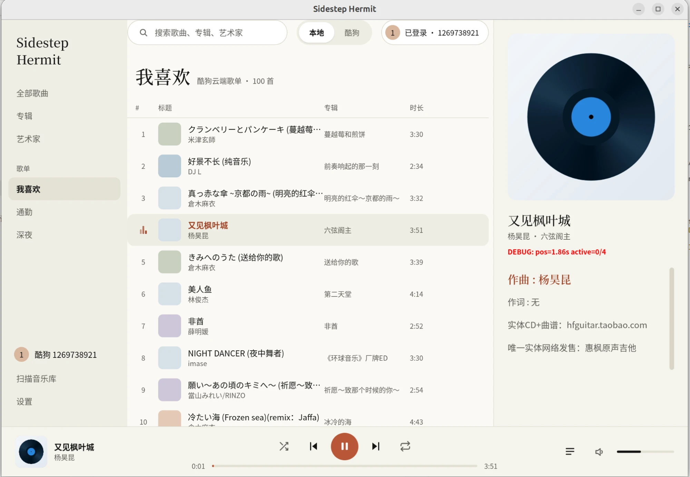

# Sidestep Hermit

<div align="center">


**🎵 一个用 Rust 写成的 Linux 音乐播放器**

*背着壳，横着走。*

**安装包仅 7.9MB，CPU 占用 < 1%**

[](https://www.gnu.org/licenses/gpl-3.0)
[](https://www.rust-lang.org)
[](https://tauri.app)

</div>

---

## 📖 简介

**Sidestep Hermit (寄居蟹)** 是一个现代化的 Linux 桌面音乐播放器，支持本地音乐库和在线音源（酷狗音乐）。

基于 **Tauri 2 + React + Rust + GStreamer** 构建，轻量、快速、跨平台。

## 📸 截图

<div align="center">



*主界面 - 播放、歌词、收藏列表*

</div>

## ✨ 特性

- 🎵 **本地音乐播放** - 支持 MP3、FLAC、OGG、WAV、M4A 等格式
- 🎤 **歌词同步显示** - LRC 格式，支持逐字高亮
- 🎨 **现代化界面** - React + CSS，像素艺术吉祥物
- 🎹 **媒体键支持** - MPRIS2 协议（Linux）
- 🔊 **10段均衡器** - 专业级音频控制
- 🔍 **全文搜索** - SQLite FTS5 全文索引
- 🌐 **在线音源** - 酷狗音乐集成（需登录）
- 🌍 **跨平台** - Linux、Windows、macOS

## 🎭 吉祥物

<div align="center">
  
  
  
  *寄居蟹家族 - 用像素艺术展现音乐的趣味*
</div>

## 🚀 快速开始

### 系统要求

**Linux (Ubuntu 24.04+ / Debian)**

```bash
sudo apt install \
    gstreamer1.0-plugins-base \
    gstreamer1.0-plugins-good \
    gstreamer1.0-plugins-bad \
    gstreamer1.0-plugins-ugly \
    gstreamer1.0-libav \
    libwebkit2gtk-4.1-dev \
    libayatana-appindicator3-dev
```

**Fedora / RHEL**

```bash
sudo dnf install \
    gstreamer1-plugins-base \
    gstreamer1-plugins-good \
    gstreamer1-plugins-bad-free \
    gstreamer1-plugins-ugly \
    gstreamer1-libav \
    webkit2gtk4.1-devel \
    libappindicator-gtk3-devel
```

### 安装

#### 从发布包安装（推荐）

下载 `.deb` 或 `.AppImage` 文件：

```bash
# Debian/Ubuntu
sudo dpkg -i kgplayer_*.deb

# AppImage (所有发行版)
chmod +x kgplayer_*.AppImage
./kgplayer_*.AppImage
```

#### 从源码编译

```bash
# 安装 Rust
curl --proto '=https' --tlsv1.2 -sSf https://sh.rustup.rs | sh

# 克隆仓库
git clone https://github.com/b76182342-source/Sidestep-Hermit.git
cd kgplayer

# 编译并运行（开发模式）
cd kg-app
cargo tauri dev --features kugou

# 构建发布版本
cargo tauri build --features kugou
```

## 🏗️ 架构

采用前后端分离的现代架构：

```
┌─────────────────────────────────────┐
│   React + TypeScript (Frontend)    │
│   Zustand + React Router            │
└──────────────┬──────────────────────┘
               │ Tauri IPC
┌──────────────┴──────────────────────┐
│   Rust Backend (Tauri 2)            │
│   - kg-player: GStreamer 播放器     │
│   - kg-lyrics: LRC 歌词解析         │
│   - kg-store: SQLite 数据库         │
│   - kg-providers: 音源适配器        │
│   - kg-mpris: MPRIS2 媒体键         │
└─────────────────────────────────────┘
```

详细架构文档：[docs/TAURI_ARCHITECTURE.md](docs/TAURI_ARCHITECTURE.md)

## 📦 项目结构

```
kgplayer/
├── kg-player/       # GStreamer 音频播放引擎
├── kg-providers/    # 音源提供者（本地 + 酷狗）
├── kg-lyrics/       # LRC 歌词解析与同步
├── kg-store/        # SQLite 数据库与持久化
├── kg-mpris/        # MPRIS2 D-Bus 服务（Linux）
└── kg-app/          # Tauri 主应用
    ├── src/         # Rust 后端
    └── src-ui/      # React 前端
```

## 🎯 开发进度

- [x] M0: 基础架构搭建
- [x] M1: 本地音乐播放 + React UI
- [x] M2: 歌词同步显示
- [x] M3: 播放列表与搜索
- [x] M6: 歌词滚动优化 (scrollIntoView API)
- [🟡] M4: 酷狗音乐集成（登录框架已完成）
- [x] M5: 打包与发布 (.deb + AppImage)

## 🎨 截图

<details>
<summary>点击展开查看应用截图</summary>

*截图即将添加*

</details>

## 🛠️ 开发

### 开发环境设置

```bash
# 安装前端依赖
cd kg-app/src-ui
npm install

# 运行开发服务器
cd ..
cargo tauri dev --features kugou
```

### 代码规范

```bash
# Rust 代码格式化
cargo fmt --all

# Rust 代码检查
cargo clippy --workspace --all-targets --all-features -- -D warnings

# 运行测试
cargo test --workspace --all-features

# 前端代码检查
cd kg-app/src-ui
npm run lint
```

## 📄 许可证

[GPL-3.0-or-later](LICENSE)

本项目依赖 GStreamer 的某些插件采用 GPL 许可证，因此整个应用也必须使用 GPL。

## 🤝 贡献

欢迎贡献！请确保：

- Rust 代码通过 `cargo fmt` 和 `cargo clippy`
- React 代码通过 `npm run lint`
- 添加必要的测试
- 遵守项目的合规红线（详见 [CLAUDE.md](CLAUDE.md)）

## 🙏 致谢

- [Tauri](https://tauri.app/) - 跨平台桌面应用框架
- [React](https://react.dev/) - UI 框架
- [GStreamer](https://gstreamer.freedesktop.org/) - 多媒体框架
- [Zustand](https://github.com/pmndrs/zustand) - 状态管理
- 社区提供的酷狗 API 文档

---

<div align="center">

**Made with 🦀 Rust and ❤️**

*22周年快乐！背着壳，横着走。*

</div>
